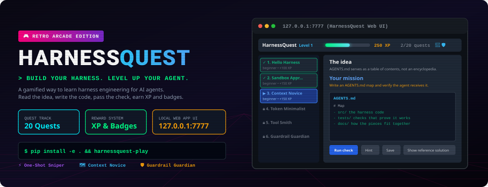
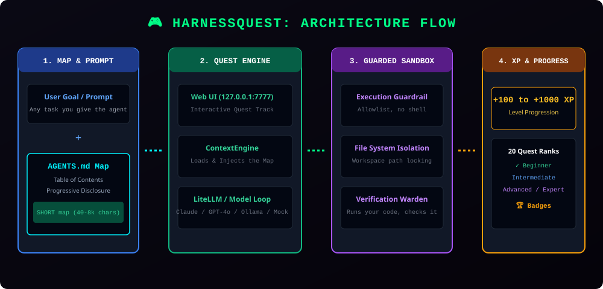

<p align="center"></p>

<p align="center">
  <a href="https://github.com/omermindivanli/harnessquest/stargazers"></a>
  <a href="https://github.com/omermindivanli/harnessquest/network/members"></a>
  <a href="LICENSE"></a>
  <a href="pyproject.toml"></a>
  <a href="https://github.com/omermindivanli/harnessquest/actions"></a>
</p>

## 🎮 What is HarnessQuest?

> **The golden law of agent systems:** `Agent = Model + Harness`

An LLM on its own is raw, untamed power. Without a harness it strays outside its boundaries, hallucinates, and loops forever.

**HarnessQuest is an open-source, retro-arcade game for learning harness engineering**: the discipline of building reliable scaffolding around AI agents. You solve 20 quests in a local web UI (or the terminal). For each one you write real code, a check actually runs it, and you earn XP and badges.

```bash
git clone https://github.com/omermindivanli/harnessquest.git && cd harnessquest
python -m venv .venv && source .venv/bin/activate
pip install -e .
harnessquest-play          # opens http://127.0.0.1:7777, no API key needed
```

## 🕹️ The 20 quests

| # | Quest | Level | XP |
|---|-------|-------|----|
| 1 | Hello Harness | beginner | +100 |
| 2 | Sandbox Apprentice | beginner | +150 |
| 3 | Context Novice | beginner | +150 |
| 4 | Token Minimalist | intermediate | +200 |
| 5 | Tool Smith | intermediate | +200 |
| 6 | Guardrail Guardian | intermediate | +250 |
| 7 | Verification Warden | advanced | +300 |
| 8-19 | Memory, providers, local LLMs, NIM, tracing, multi-agent, specs, condensation, security, evals, architecture, hardening | mixed | +300 to +700 |
| 20 | Harness Grandmaster | expert | +1000 |

## 📐 Architecture flow

<p align="center"></p>

---

## 🎯 What is Harness Engineering?

> **Harness Engineering** is the discipline of designing, building, and iterating on the scaffolding that surrounds a language model in an agentic system. It has four primary levers:
> 1. **Context Design** — What the model knows before it starts
> 2. **Tool Selection** — Which tools the model has access to
> 3. **Constraint Management** — Time budgets, loop detection, verification gates
> 4. **Production Hardening** — Sandboxing, memory compaction, observability

*The model is a commodity. The harness is the moat.*

---

## ✨ Features

### 🌐 Multi-Provider LLM Support
| Provider | Models | Best For |
|----------|--------|----------|
| **Ollama** (Local) | Llama 3.1, Nemotron, CodeLlama, Qwen | Learning, privacy, offline, free |
| **OpenAI** | GPT-4o, GPT-4o-mini, o1-preview | Production, best general models |
| **Anthropic** | Claude 3.5 Sonnet/Haiku, Opus | Coding, reasoning, large context |
| **NVIDIA NIM** | Nemotron, Llama, Mistral | Enterprise, GPU-optimized |
| **LiteLLM** | 100+ providers | Unified gateway, fallback routing |

### 🛡️ Secure Execution Sandbox
- Path traversal protection (`../../../etc/passwd` → blocked)
- Command allowlist, no shell (pipes, redirects and `$(...)` are refused)
- Every path argument resolved through symlinks and kept inside the workspace
- Scrubbed environment (API keys never reach child processes), 15-second timeout, CPU/file-size limits
- Teaching sandbox, not an OS boundary: use a container for untrusted code

### 🧠 Context Engineering
- **AGENTS.md** as map (not encyclopedia) — progressive disclosure
- Repository tree generation fallback
- Token-efficient prompt injection
- Conversation condensation (Level 15)

### 🎮 20-Level Gamification System
| Tier | Levels | Focus | XP Range |
|------|--------|-------|----------|
| **Foundation** | 1-4 | Loop, Sandbox, Context, Tokens | 100-200 |
| **Engineering** | 5-9 | Tools, Constraints, Verification, Memory, Multi-Model | 200-350 |
| **Specialization** | 10-14 | Local LLM, NIM, Observability, Multi-Agent, Specs | 300-450 |
| **Mastery** | 15-20 | Condensation, Security, Eval, Architecture, Production, Capstone | 500-1000 |

**Badges**: ⚡ SNIPER (1 turn), 🍃 MINIMALIST (<1200 tokens), 🛡️ IRONCLAD (0 faults), ⏱️ SPEEDSTER (<2s) + 20 quest badges

### 📊 Observability & Evaluation
- LLM-as-Judge verification (`HarnessJudge`)
- Token tracking, latency measurement, fault counting
- GitHub Actions CI with benchmark regression detection
- OpenTelemetry-ready (Level 12)

### 🔧 Production Patterns
- Spec-driven development (`feature_list.json`)
- Session persistence & resumption (Level 8)
- Multi-agent orchestration (Level 13)
- Prompt injection defense (Level 16)
- Continuous doc-gardening (OpenAI pattern)

---

## 🚀 Quick Start (5 Minutes)

### 1. Install

```bash
git clone https://github.com/omermindivanli/harnessquest.git
cd harnessquest
python -m venv .venv
source .venv/bin/activate
pip install -e .
```

### Play in your browser (recommended)

```bash
mkdir my-harness-journey            # any empty folder: your progress and code live here
harnessquest-play --dir my-harness-journey
```

Opens http://127.0.0.1:7777 (use `--port` to change it) with the 20 quests, an in-browser code editor, hints, a sandbox
playground and a **Run check** button that really executes and tests your code. Everything runs
locally; nothing is sent anywhere unless you pick a cloud provider for Level 1.

### 2. Try it with no API key (offline demo)

```bash
harnessquest-quest 1 --provider mock
harnessquest-quest --dashboard
```

### 3. Choose Your Provider

#### 🆓 Option A: Ollama (Local, Free, Private) — **Recommended for Learning**
```bash
# Install: https://ollama.com
ollama serve
ollama pull llama3.1:8b

# Play Level 1
harnessquest-quest 1 --provider ollama --model llama3.1:8b
```

#### ☁️ Option B: OpenAI
```bash
echo "OPENAI_API_KEY=sk-your-key" > .env
harnessquest-quest 1 --provider openai --model gpt-4o-mini
```

#### ☁️ Option C: Anthropic
```bash
echo "ANTHROPIC_API_KEY=sk-ant-your-key" > .env
harnessquest-quest 1 --provider anthropic --model claude-3-5-haiku-20241022
```

#### ☁️ Option D: NVIDIA NIM
```bash
echo "NVIDIA_API_KEY=nvapi-your-key" > .env
echo "NVIDIA_NIM_BASE_URL=https://integrate.api.nvidia.com/v1" >> .env
harnessquest-quest 1 --provider nim --model meta/llama-3.1-70b-instruct
```

### 4. Start Your Journey

```bash
# See all quests
harnessquest-quest --list

# View your progress
harnessquest-quest --dashboard

# Play Level 1
harnessquest-quest 1
```

---

## 📚 Learning Path

### Start here
- **[Playbook](docs/PLAYBOOK.md)** — exactly what to build at each of the 20 levels and how it is checked

### Tutorials
1. **[Getting Started](docs/tutorials/01-getting-started.md)** — Install, configure, run first quest
2. **[Understanding the Loop](docs/tutorials/02-understanding-the-loop.md)** — Agent loop internals
3. **[Context Engineering](docs/tutorials/03-context-engineering.md)** — Progressive disclosure, token budgets

4. **[Tool Design](docs/tutorials/04-tool-design.md)**
5. **[Constraint Management](docs/tutorials/05-constraint-management.md)**
6. **[Evaluation Patterns](docs/tutorials/06-evaluation-patterns.md)**
7. **[Multi-Provider](docs/tutorials/07-multi-provider.md)**
8. **[Local LLMs](docs/tutorials/08-local-llms.md)**
9. **[Observability](docs/tutorials/09-observability.md)**
10. **[Production Hardening](docs/tutorials/10-production-hardening.md)**

### Quest Walkthroughs
- [Level 1: Initiate](docs/quests/level-01-initiate.md) — Hello Harness
- [Level 2: Sandbox Apprentice](docs/quests/level-02-sandbox-apprentice.md) — Execution Boundaries
- Levels 3-20: see the [Playbook](docs/PLAYBOOK.md)

### Branding
- [Brand Guide](docs/BRAND_GUIDE.md) and [X Launch Kit](docs/X_LAUNCH_KIT.md)

### Architecture Diagrams
- [System Architecture](docs/architecture/system-architecture.svg)
- [Agent Loop Flow](docs/architecture/agent-loop-flow.svg)
- [Provider Abstraction](docs/architecture/provider-abstraction.svg)
- [Gamification Progression](docs/architecture/gamification-progression.svg)
- [Context Engineering Pipeline](docs/architecture/context-engineering-pipeline.svg)

### Best Practices
- [Harness Engineering Principles](docs/best-practices/harness-engineering-principles.md) — Synthesized from OpenAI, Anthropic, Manus, LangChain, WalkingLabs
- [Provider Guides](docs/providers/README.md) — Setup for each provider

---

## 🏗️ Project Structure

```
harnessquest/
├── harnessquest/
│   ├── core/                    # Runner, Context, Sandbox, Config, Providers
│   │   ├── runner.py            # Agent loop orchestration
│   │   ├── context.py           # AGENTS.md, repo maps, progressive disclosure
│   │   ├── sandbox.py           # Secure execution boundaries
│   │   ├── config.py            # Pydantic Settings, .env management
│   │   └── providers.py         # OpenAI, Anthropic, NIM, Ollama, LiteLLM
│   ├── gamification/            # XP, Levels, Quests, Progression
│   │   ├── xp.py                # XP calculation, badges
│   │   ├── levels.py            # 20 quest definitions
│   │   └── progression.py       # Player profile, dashboard
│   ├── cli/                     # Main CLI + Quest CLI
│   │   ├── main.py              # harnessquest command
│   │   └── quest_mode.py        # harnessquest-quest command
│   ├── eval/                    # LLM-as-Judge evaluation
│   │   └── judge.py             # Automated verification
│   └── middleware/              # LangChain adapter
├── tests/                       # Unit tests
├── docs/                        # Documentation
│   ├── architecture/            # SVG diagrams
│   ├── tutorials/               # 10 step-by-step guides
│   ├── quests/                  # 20 quest walkthroughs
│   ├── providers/               # Provider setup guides
│   └── best-practices/          # Industry principles
└── .github/workflows/           # CI/CD evaluation
```

---

## 🔧 CLI Reference

### Main Harness Runner
```bash
harnessquest --prompt "Task" --provider ollama --model llama3.1:8b
harnessquest --list-providers
harnessquest --list-models --provider openai
harnessquest --provider-help ollama
```

### Quest Mode
```bash
harnessquest-quest --list           # All 20 quests with status
harnessquest-quest --dashboard      # Player profile, XP, badges
harnessquest-quest 1                # Play Level 1
harnessquest-quest 5 --provider openai --model gpt-4o
```

### Python API
```python
from harnessquest import HarnessRunner, get_provider

# Direct runner usage
runner = HarnessRunner(model="gpt-4o-mini", provider="openai", max_turns=10)
result = await runner.run("List files and output [TASK_COMPLETE]")

# Provider abstraction
provider = get_provider("anthropic")
response = await provider.complete(messages, "claude-3-5-sonnet-20241022")
```

---

## 📖 Key References

This project synthesizes patterns from industry leaders:

| Source | Key Contribution |
|--------|------------------|
| **OpenAI (Codex)** | AGENTS.md as map, progressive disclosure, doc-gardening agents |
| **Anthropic (Claude Code)** | Initializer agent, feature_list.json, self-verification, handoff artifacts |
| **Manus** | KV-cache optimization, filesystem memory, tool masking |
| **LangChain (DeepAgents)** | Middleware, orchestration, eval harness (rank 30→5) |
| **WalkingLabs** | CAR decomposition, HarnessCard, spec-driven course |
| **Snowan/Study Notes** | 4 architecture patterns, 10 mistakes, MVH |

---

## 🤝 Contributing

We welcome contributions! See [CONTRIBUTING.md](CONTRIBUTING.md) for guidelines.

### Development Setup
```bash
pip install -e ".[dev]"
pytest tests/ -v
ruff check .
black .
```

### Areas for Contribution
- New quest levels (21+)
- Additional providers (Azure, Bedrock, Vertex, etc.)
- More architecture diagrams
- Tutorial translations
- Benchmark datasets
- Observability integrations (Grafana, Jaeger, etc.)

---

## 📄 License

MIT License — see [LICENSE](LICENSE) for details.

---

## 🙏 Acknowledgments

- **OpenAI** for the Codex harness engineering blog post
- **Anthropic** for effective harnesses research
- **WalkingLabs** for the learn-harness-engineering course
- **Manus** team for context engineering insights
- **LangChain** for DeepAgents benchmark proof
- **Snowan** for the practical harness building guide
- **Vikas Sah** for the definitive guide to agent harness engineering

---

## 🔗 Links

- **GitHub**: https://github.com/omermindivanli/harnessquest
- **Issues**: https://github.com/omermindivanli/harnessquest/issues
- **Discussions**: https://github.com/omermindivanli/harnessquest/discussions

---

**Ready to become a Harness Grandmaster?** 👑

```bash
harnessquest-quest 1
```